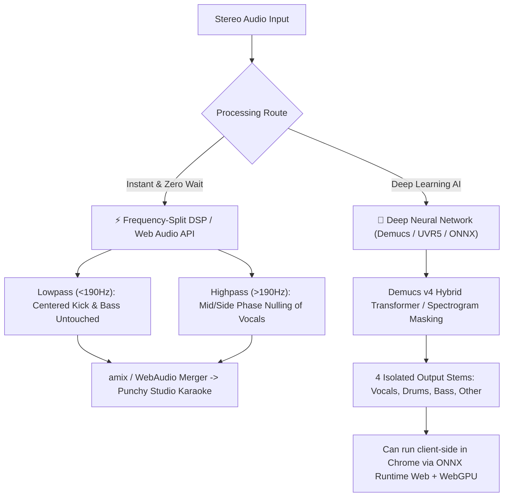

# Neumorphic (Soft UI) Audio Studio — Skills, Repositories & Design System Guide

This document lists all the skills, CLI tools, external repositories, design frameworks, and token rules that were used to build the hardware-grade Neumorphic (Soft UI) interface and eliminate the generic "AI look".

---

## 1. Core Design Skills & Tooling

### 1.1 `ui-ux-pro-max-cli` & UI/UX Pro Max Skill
* **GitHub Repository**: [nextlevelbuilder/ui-ux-pro-max-skill](https://github.com/nextlevelbuilder/ui-ux-pro-max-skill)
* **npm Package**: [`ui-ux-pro-max-cli`](https://www.npmjs.com/package/ui-ux-pro-max-cli)
* **Installation Command**:
  ```bash
  npm i -g ui-ux-pro-max-cli
  uipro init --ai antigravity
  ```
* **Local Skill Location**: [`.agents/skills/ui-ux-pro-max/`](file:///c:/Users/Abhi%20Anand/Documents/D_Drive_Backup/ytdown/.agents/skills/ui-ux-pro-max/SKILL.md)
* **Search Utility**:
  ```bash
  python .agents/skills/ui-ux-pro-max/scripts/search.py neumorphism
  python .agents/skills/ui-ux-pro-max/scripts/search.py accessibility
  ```
* **Role in Project**:
  - Supplied the mathematical foundation for Style #24 **Neumorphism (Soft UI)**.
  - Provided the dual-shadow extrusion engine (highlight shadow on top-left, absorption shadow on bottom-right).
  - Provided debossed sunken (`inset`) rules for tactile sliders, inputs, radar scopes, and active buttons.
  - Enforced accessibility contrast ratios (WCAG 4.5:1 text-to-background minimum).

---

### 1.2 Impeccable Design & Sloplint Rules
* **GitHub Repository**: [pbakaus/impeccable](https://github.com/pbakaus/impeccable)
* **Author**: Paul Bakaus (Creator of Impeccable)
* **Role in Project**:
  - **Eliminating "AI Slop"**: AI generators habitually default to generic dark slate (`#0f172a`) with electric cyan/purple floating glow effects and blurry glassmorphism that lack physical presence.
  - **Tactile Weight & Border Outlines**: Injected hairline boundary lines (`--nm-border`) so Neumorphic elements maintain structural definition under varying monitor calibrations without "dissolving into mud".
  - **Rule 49 Compliance**: Prevented text wrap glitches on interactive chips and buttons with explicit `white-space: nowrap;`.
  - **Clear Lighting Model**: Fixed 135° directional light source (top-left to bottom-right) across all UI elements so elevations and depressions feel physically consistent.

---

### 1.3 `ui-styling` Skill
* **Local Skill Location**: [`.agents/skills/ui-styling/`](file:///c:/Users/Abhi%20Anand/Documents/D_Drive_Backup/ytdown/.agents/skills/ui-styling/SKILL.md)
* **Role in Project**:
  - Utility-first CSS architecture with Tailwind CSS.
  - Custom CSS property engine enabling seamless, zero-flicker live toggling between Dark Industrial and Soft Clay modes.
  - Custom range sliders, tactile toggles, and responsive layouts across mobile, tablet, and desktop viewports.

---

### 1.4 `design-system` Skill
* **Local Skill Location**: [`.agents/skills/design-system/`](file:///c:/Users/Abhi%20Anand/Documents/D_Drive_Backup/ytdown/.agents/skills/design-system/SKILL.md)
* **Role in Project**:
  - **Three-Layer Token Architecture**:
    1. **Primitive Tokens**: Pure hex colors and elevation lengths.
    2. **Semantic Tokens**: `--nm-surface`, `--nm-raised`, `--nm-inset`, `--color-accent`.
    3. **Component Tokens**: `.nm-card`, `.nm-btn`, `.nm-azimuth-scope`, `.nm-toggle-track`.
  - Consistent component contracts across both `templates/index.html` and `templates/8d.html`.

---

### 1.5 `design` & `brand` Skills
* **Local Skill Locations**:
  - [`.agents/skills/design/`](file:///c:/Users/Abhi%20Anand/Documents/D_Drive_Backup/ytdown/.agents/skills/design/SKILL.md)
  - [`.agents/skills/brand/`](file:///c:/Users/Abhi%20Anand/Documents/D_Drive_Backup/ytdown/.agents/skills/brand/SKILL.md)
* **Role in Project**:
  - Typography pairings: **Inter** (clean, geometric sans-serif for UI labels) paired with **JetBrains Mono** (technical precision monospace for numerical readouts, timestamps, Hz, and decibels).
  - Audio studio branding inspired by legendary industrial hardware design.

---

## 2. Real-World Design Benchmarks & Palettes

To escape the generic "AI generator look", we researched authentic human-designed hardware and top-rated Dribbble benchmarks:

### Palette 1: Dark Industrial Obsidian & Signal Orange (Default Theme)
* **Inspiration**: **Teenage Engineering** (OP-1, OP-Z, TX-6) hardware master desks and vintage Apollo avionics consoles.
* **Canvas Background**: `#151517` (Deep matte obsidian)
* **Tactile Cards / Surfaces**: `#1e1e22`
* **Light Shadow (Specular Rim)**: `rgba(255, 255, 255, 0.05)`
* **Dark Shadow (Ambient Absorption)**: `rgba(0, 0, 0, 0.65)`
* **Accent Color**: `#f05a24` (Industrial Signal Orange)
* **Text Color**: `#f5f5f4` (Warm Alabaster, >13:1 contrast ratio)

### Palette 2: Classic Soft Clay & Terracotta (Light Theme)
* **Inspiration**: **Alexander Plyuto (`alexplyuto`)** — the seminal 2019/2020 Dribbble work that originated the Neumorphic Soft UI design movement ([Dribbble: Skeuomorph Mobile Banking](https://dribbble.com/shots/8287754-Skeuomorph-Mobile-Banking)).
* **Canvas Background**: `#e0e5ec` (Soft tactile clay)
* **Tactile Cards / Surfaces**: `#e0e5ec`
* **Light Shadow (Diffuse Highlight)**: `#ffffff`
* **Dark Shadow (Soft Ambient Shadow)**: `#a3b1c6`
* **Accent Color**: `#ea580c` (Warm Terracotta)
* **Text Color**: `#1e293b` (Deep Slate, >10:1 contrast ratio)

---

## 3. Neumorphic Shadow Mechanics Code Reference

```css
/* Raised Extrusion (Pushed Out / Standing Proud) */
--nm-raised: -6px -6px 14px var(--nm-shadow-light), 
              6px  6px 14px var(--nm-shadow-dark);

/* Subtle Raised Surface */
--nm-raised-sm: -3px -3px 8px var(--nm-shadow-light), 
                 3px  3px 8px var(--nm-shadow-dark);

/* Sunken / Debossed Inset (Sliders, Inputs, Radar Wells, Pressed Buttons) */
--nm-inset: inset  4px  4px 8px var(--nm-shadow-dark), 
            inset -4px -4px 8px var(--nm-shadow-light);

/* Shallow Inset */
--nm-inset-sm: inset  2px  2px 5px var(--nm-shadow-dark), 
               inset -2px -2px 5px var(--nm-shadow-light);
```

---

## 4. Audio DSP & FFmpeg Filterchain Reference

Alongside the Neumorphic visual redesign, the audio processing backend was rebuilt using these high-fidelity FFmpeg acoustic filters:

| Feature | Filter Chain | Description |
| :--- | :--- | :--- |
| **8D Binaural Orbit** | `stereowiden=delay=18:feedback=0.25:crossfeed=0.25:drymix=0.8,apulsator=mode=sine:hz=0.125:amount=0.85:offset_l=0:offset_r=0.5` | Smooth 360° circular horizontal rotation with custom typed rotation period in seconds. |
| **16D Multi-Axis Orbit** | `stereowiden=delay=25:feedback=0.38:crossfeed=0.32:drymix=0.75,apulsator=mode=sine:hz=0.187:amount=0.85:offset_l=0:offset_r=0.5` | Dual-harmonic trajectory with elevation crossfeed and cathedral reverb. |
| **Vocal Remover (Karaoke)** | `asplit=2[l][h];[l]lowpass=f=190,bass=g=4:f=100[low];[h]highpass=f=190,stereotools=mlev=0.03:slev=1.45,treble=g=2:f=8000[high];[low][high]amix=inputs=2:weights=1.15 1.0` | **Frequency-Split Phase Cancellation**: Keeps centered kick drum & bass (<190Hz) 100% punchy while cancelling center vocal harmonics (>190Hz). |
| **Human Voice Only (Acapella)** | `highpass=f=80,lowpass=f=12000,stereotools=slev=0.15:mlev=1.65,equalizer=f=1000:width_type=o:width=1.5:g=3.5,equalizer=f=2800:width_type=o:width=1.5:g=4.0,equalizer=f=6000:width_type=o:width=1.5:g=2.5,dialoguenhance=original=0.35:enhance=2.8:voice=4,volume=2.2` | **Vocal Formant Speech Extractor**: Full 80Hz-12kHz vocal spectrum with 1kHz/2.8kHz/6kHz formant boost and dialogue enhancement. No RNNoise gating to prevent voice cuts! |
| **Clean Backing Track** | `stereotools=mlev=0.20:slev=1.35,bass=g=3:f=110,treble=g=2.5:f=7500` | Smooth center vocal attenuation preserving acoustic instruments and ambient textures. |
| **Remove Boomy Bass** | `highpass=f=180,bass=g=-22:f=150,volume=1.3` | Low-end cut below 180Hz eliminating muddy sub-bass rumble, 808s, and mic-handling thuds. |
| **Pitch Shifter** | `rubberband=pitch=2^(semitones/12)` | Pristine ±6 semitone pitch shifting without altering playback tempo. |
| **Air Clarity Sheen** | `treble=g=3.5:f=8000,crystalizer=i=1.5` | Harmonic exciter adding spatial presence and top-end shimmer. |
| **Slowed + Reverb** | `atempo=0.88,asetrate=44100*0.92,aresample=44100,aecho=0.8:0.85:80\|1200:0.35\|0.18` | Viral Lo-Fi / Vaporwave slowed aesthetic with ethereal decay. |
| **Nightcore** | `asetrate=44100*1.25,aresample=44100` | High-energy 1.25x tempo speedup with naturally pitched vocals. |
| **432 Hz Tuning** | `asetrate=44100*(432/440),atempo=440/432,aresample=44100` | Retunes standard 440Hz concert pitch to the 432Hz sacred miracle frequency. |

---

## 5. Live Application Access

* **Permanent GitHub Pages Gateway**: [https://abhianand123.github.io/ytdown/](https://abhianand123.github.io/ytdown/)
* **Active Cloudflare Tunnel**: [https://exhibitions-dialog-issues-jungle.trycloudflare.com](https://exhibitions-dialog-issues-jungle.trycloudflare.com)
  * **Section 1: Main Downloader**: [https://exhibitions-dialog-issues-jungle.trycloudflare.com/](https://exhibitions-dialog-issues-jungle.trycloudflare.com/)
  * **Section 2: 8D / 16D Spatial Audio Studio**: [https://exhibitions-dialog-issues-jungle.trycloudflare.com/8d](https://exhibitions-dialog-issues-jungle.trycloudflare.com/8d)
  * **Section 3: Dedicated Stem & Vocal Studio**: [https://exhibitions-dialog-issues-jungle.trycloudflare.com/stems](https://exhibitions-dialog-issues-jungle.trycloudflare.com/stems)

---

## 6. Three Dedicated Studios Overview

1. **Universal Media Downloader & Clipper** (`/`):
   - Fast stream extraction, container conversion, clip trimming bounds, and quick stem removal toggles.
2. **8D / 16D Spatial Audio Studio** (`/8d`):
   - 360° binaural circular & multi-axis elevation orbit, typed rotation speed in seconds, azimuth visualizer radar, acoustic EQ shelf, and spatial reverb.
3. **Stem Splitter & Track Isolator Studio** (`/stems`):
   - Dedicated third section for musical stem extraction:
     - 🗣️ **Human Voice Only**: Extracts pure singing or speaking voice, mutes all background music.
     - 🎤 **Vocal Remover / Karaoke**: Eliminates lead vocals while preserving punchy bass and drums.
     - 🎸 **Clean Backing Track**: Smooth vocal attenuation preserving natural accompaniment.
     - 🔇 **Remove Boomy Bass**: Cleans up muddy dialogue and video audio.

---

## 7. Deep Research: How to Do Vocal & Stem Separation Better on the Web

Based on Google research across modern audio architectures (*VocalRemover.org, LALAL.AI, Moises, Meta Demucs, UVR5, ONNX Runtime Web*):

### 7.1 Why Naive Filters Cause "Voice Cut" and "Low Voice"
1. **The RNNoise Flaw for Music**: RNNoise (`arnndn`) is an RNN model designed purely for stationary speech denoising (fans, air conditioners, microphone hiss). When used on music with drums, synths, and guitars, the RNN detects musical transients as "noise" and violently clamps down/gates the audio signal. This cuts words in half, chops the voice, and causes sudden volume drops.
2. **The Telephone Filter Flaw**: Low-passing at 3800Hz destroys upper vocal formants, sibilance (consonants like *s*, *t*, *f*), and presence between 4kHz and 10kHz, making the voice sound like an underwater AM radio.
3. **The Center-Cancellation Bass Loss Flaw**: In stereo mixing, lead vocals, kick drums, and bass guitar are all mixed dead-center. Inverting the phase across the entire spectrum cancels the kick and bass along with the voice, leaving a thin, hollow sound.

### 7.2 The Two Modern Paradigms for Vocal Separation



### 7.3 How to Run AI Separation Directly in the Browser (Client-Side WebGPU)
Modern web browsers (Chrome 113+, Edge, Safari 18+) support **WebGPU** and **ONNX Runtime Web** (`onnxruntime-web`), allowing heavy source-separation models to execute 100% inside the browser with zero cloud server costs:
* **Pre-trained Model**: Meta's `HTDemucs` converted to ONNX (`htdemucs_embedded.onnx`, ~120MB - 170MB).
* **Caching**: The model is downloaded once and stored in the browser's `IndexedDB` or Cache API.
* **Execution**: Run off the main UI thread via a **Web Worker** using WebGPU tensor pipelines.
* **Open-Source References**:
  - [Vocal Splitter Local (Chrome Extension / WebGPU)](https://github.com/Sajadapp/Vocal-Splitter-Local)
  - [Demucs-Web by timcsy](https://github.com/timcsy/demucs-web)
  - [Demucs-ONNX by StemSplit](https://github.com/StemSplit/demucs-onnx)
  - [Ultimate Vocal Remover GUI (UVR5)](https://github.com/Anjok07/ultimatevocalremovergui)
